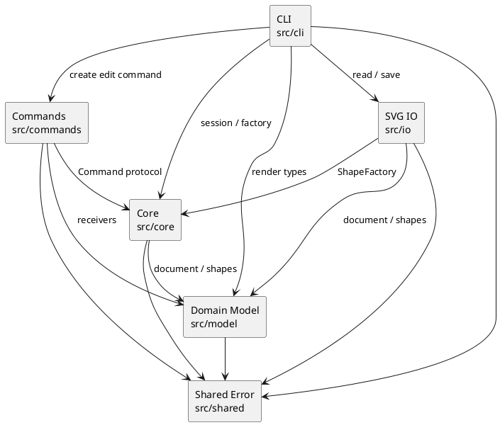

# Lab1 Phase 1：SVG 编辑器（CLI）

## 项目与仓库地址

- 本地 Git 仓库：`file:///G:/桌面/高级软件开发技术`
- 远程 GitHub 地址：[https://github.com/withtst/svg-editor-cli](https://github.com/withtst/svg-editor-cli)

当前仓库已经用 Git 管理，并保留了分步提交和最终 `final` tag 所需的提交结构。

## 运行方式

要求 Node.js 18+。

```bash
npm install
npm test
npm run cli
```

CLI 启动后提示符为 `svg>`。例如：

```text
svg> init 800 600
canvas 800x600 created
svg> create g flowchart
g#flowchart created
svg> create rect start 120 100 160 60 #4a90d9 in flowchart
rect#start created in g#flowchart
svg> create text start-label 155 135 "开始" in flowchart
text#start-label created in g#flowchart
svg> tree
svg (800x600)
└── g#flowchart
    ├── rect#start  x=120 y=100 w=160 h=60 fill=#4a90d9
    └── text#start-label  (155,135) "开始"
```

支持 `init`、`read`、`save`、`canvas`、`create`、`delete`、`move`、`scale`、`set`、`group`、`ungroup`、`addto`、`front`、`back`、`tree`、`show`、`help`、`undo` 和 `redo`。`create` 当前内置 `rect`、`circle`、`ellipse`、`line`、`text`、`g` 六种类型；`box` 按阶段要求暂不实现，会返回 `unknown shape type`。

## 架构方案

### 1. 模块划分

| 模块 | 目录 | 职责 |
|---|---|---|
| 领域模型 | `src/model/` | `Shape` 抽象基类、五种叶子图形、`GroupShape` 容器和 `SvgDocument`；封装几何属性、父子关系、移动与缩放语义。 |
| 命令 | `src/commands/` | 每条可编辑 CLI 命令一个类，负责校验、执行和逆操作；包括创建、删除、移动、缩放、属性设置、分组、解组、归属和 z-order。 |
| 核心协调 | `src/core/` | `EditorSession` 管理当前文档与 IO 锁定状态，`CommandHistory` 管理 undo/redo，`ShapeFactory` 创建六种内置图形。 |
| 文件 IO | `src/io/` | `XmlParser` / `SvgParser` 读入 SVG，`SvgSerializer` 序列化 SVG，`FileService` 隔离文件系统。缺失 id 的补全和 warning 也在此完成。 |
| CLI | `src/cli/` | 参数分词、命令名到处理器的分发、`tree` / `show` / `help` 的展示，以及 readline 入口。 |
| 共享错误 | `src/shared/` | `AppError`，供各层传递可展示的业务错误；不依赖任何上层模块。 |

组件关系如下：



### 2. 设计模式的选择

#### Command 模式（本阶段的强制要求）

- `Command` 是统一协议，约定 `execute()` 和 `undo()`。
- `CreateCommand`、`DeleteCommand`、`MoveCommand`、`ScaleCommand`、`SetAttributeCommand`、`GroupCommand`、`UngroupCommand`、`AddToCommand`、`ZOrderCommand` 是具体命令。
- `EditorSession` 是调用入口，`CommandHistory` 是 undo/redo 管理者；`SvgDocument` 和各 `Shape` 是接收者。
- 一条编辑命令对应一个 history 单元。`group g1 r1 c1` 的多个摘出和收入动作由一个 `GroupCommand` 完成，因此 undo 一次即可恢复全部结构。
- `init`、`read`、`save` 和带参数的 `canvas` 属于文档/IO 命令，不进入编辑命令栈，并按约定锁定 undo/redo；下一条编辑命令成功执行后重新解禁。

#### Composite 模式

`GroupShape` 与叶子图形都继承 `Shape`。`move`、`scale`、`delete`、`set` 的接收对象不需要由 CLI 区分叶子或容器；容器把操作递归转发给子树，从而实现统一操作语义。

#### Factory / Registry

`ShapeFactory` 通过 `creators` 注册表创建六种内置类型。新增类型时可以增加 provider，而不需要把创建逻辑散落到 CLI。阶段 1 的 `box` 插件槽只在架构上预留，当前按要求返回未知类型错误。

按名字分派只保留两个明确边界：

1. `CommandDispatcher.handlers`：命令名 → 命令处理器；
2. `ShapeFactory.creators`：图形类型名 → 图形构造器。

这两处分别是 CLI 入口和图形工厂的天然注册点，其他领域行为通过多态方法完成，没有到处使用 `switch(tag)`。

### 3. 依赖方向规则

规则从上到下为：

1. `src/shared` 不依赖任何业务模块。
2. `src/model` 只依赖 `src/shared`，不依赖 CLI、命令、IO；领域模型不能知道用户输入和文件格式。
3. `src/core` 可以依赖 `src/model` 和 `src/shared`，不能依赖具体命令或 CLI。
4. `src/commands` 可以依赖 `src/core` 中的 `Command` 协议、`src/model` 和 `src/shared`，不能依赖文件系统和 readline。
5. `src/io` 可以依赖 `src/core` 的工厂、`src/model` 和 `src/shared`，不能反向调用 CLI。
6. `src/cli` 是组装层，可以依赖上述模块；其他模块不得反向依赖 `src/cli`。

这样，领域模型可以独立测试，文件格式可以替换，命令可以在 GUI 或 agent 通道复用。违反规则的依赖应作为待处理项记录，不通过增加跨层快捷调用来解决。

### 4. 变化点假设

| 可能变化 | 当前留出的接口/位置 | 当前决定不留的部分 |
|---|---|---|
| 新增 SVG 图形或 `box` 插件 | `ShapeFactory` 的注册表、`Shape` 多态接口；后续可抽出 `ShapeProvider` | 阶段 1 不实现 `box` 的领域语义，避免提前把插件逻辑塞进内核。 |
| CLI 命令语法或增加 GUI/HTTP 通道 | `Tokenizer` 与 `CommandDispatcher` 隔离输入；命令类不读取 stdin | 不为未来 GUI 复制一套业务逻辑，直接复用命令对象。 |
| SVG 序列化格式或输入来源 | `SvgParser`、`SvgSerializer`、`FileService` 独立 | 本阶段只覆盖题目列出的六种 SVG 元素，不实现 `path`、滤镜、CSS 等扩展。 |
| 组合图形的领域语义 | `GroupShape` 统一处理子树；`data-kind` 可供后续 provider 识别 | 当前未安装 box 插件时按普通 `g` 降级，不伪造 box 的 `fill`/`label` 传播规则。 |
| 历史策略和持久化 | `CommandHistory` 与具体命令分离 | 暂不把 undo 栈持久化到 SVG；SVG 文件只保存图形状态。 |

## 过程记录

1. 先根据题目把领域模型、命令、IO 和 CLI 分层，再实现 `Shape` 多态和 `GroupShape` 的统一操作，避免先写一个包含所有 `switch` 的上帝类。
2. 编译阶段发现 `GroupShape` 没有实现抽象的几何属性接口；补上空几何属性后，容器和叶子可以共享 `Shape` 协议。
3. 手工回放典型流程图时发现 Windows 路径放在引号中会被 tokenizer 吞掉反斜杠；随后把反斜杠处理改为只转义引号和反斜杠，普通路径分隔符保持原样。
4. 手工验证 `ungroup` 时发现测试场景把容器放在 SVG 根层，和题目明确的“禁止解散根级容器”冲突；保留实现的规则，并把测试改为先将容器放入父容器。
5. 读写 round-trip 验证了缺失 id 自动补全、warning、嵌套分组、中文文本和 XML 转义；随后补充了 redo 栈清空和 IO 后禁止 undo 的测试。
6. 检查 Git 环境时发现当前目录原本不是仓库，且本机 GitHub CLI 的 token 已失效；在确认项目名并由用户提供远程地址后，再配置 `origin` 并执行推送。

## 一致性自查

### 1. 模块划分

实际目录与方案一致：`src/model`、`src/commands`、`src/core`、`src/io`、`src/cli` 均已实现；实现过程中为避免领域层与协调层形成循环依赖新增了 `src/shared/AppError.ts`，已在上面的模块划分和依赖图中同步记录。

### 2. 依赖方向

方案规则未发现违反项：模型层没有导入 CLI、命令或 IO；命令类不访问文件和 stdin；文件读写集中在 `src/io`；只有 CLI 负责把输入分派到命令。按名字的注册分派仅位于 `CommandDispatcher` 和 `ShapeFactory` 两处。

## 质量保证手段

- 静态检查：`npm run build` 使用 TypeScript strict 模式编译整个 `src/`。
- 自动化测试：`npm test` 覆盖创建、嵌套容器、移动、缩放、属性设置、分组/解组、删除恢复、redo 清空、错误消息、SVG 读写、缺失 id 警告、中文文本和 IO 锁定。
- 手工回放：按照题目中的流程图会话创建 `g#flowchart`、节点、文字和连线，检查 `tree`、`show`、`move`、`undo`、`redo` 与 `save` 的输出。
- 状态安全：编辑命令先做 id、父容器、数值、循环归属等校验；失败命令不会进入 history，几何属性更新也在校验通过后才写入。
- 可复现性：项目只使用 Node.js 内置模块和 TypeScript，依赖锁定在 `package-lock.json`；生成的 `dist/` 和临时 SVG 不提交到 Git。
